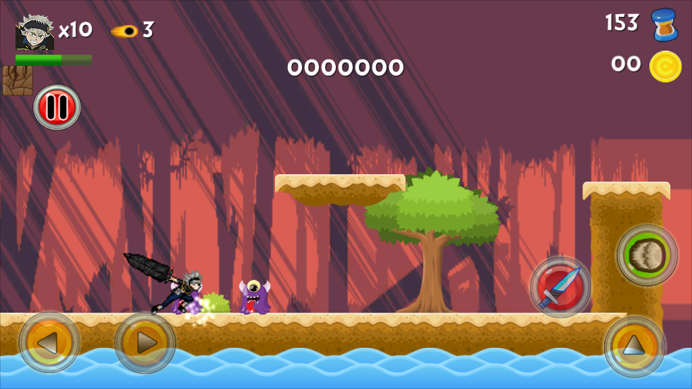
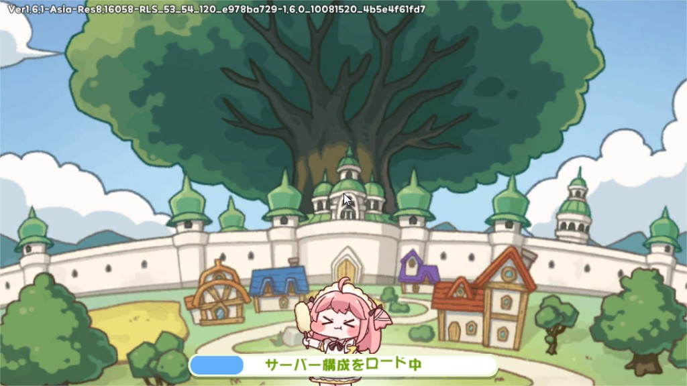

# Lunaria

### Android apps and games, on your desktop.

No Android system image required. ARM32 and ARM64, from the original package.

[](LICENSE)
[](#how-it-works)
[](#compatibility)
[](https://github.com/sponsors/yui0)

[Install](#install) · [Gallery](#gallery) · [Compatibility](#compatibility) · [Build from source](#quick-start) · [日本語](README.ja.md)

**Lunaria brings Android applications and games to the desktop without running a full Android OS.**
Instead of booting a virtual device, it loads the app's own package, executes its ARM32 or ARM64 code with
[dynarmic](https://github.com/merryhime/dynarmic), and bridges Android services such as JNI, EGL, OpenGL ES,
and MediaCodec to the host. A built-in Dalvik interpreter handles Java bytecode from the app's `classes*.dex`.

Open an `.apk`, `.xapk`, `.apks`, or `.aab` directly. Lunaria takes care of extraction, manifests,
split APKs, package caching, and separate account profiles. For WebView content, it uses an installed
Chrome/Chromium browser or the included [luna-browser](luna-browser/) through the Chrome DevTools protocol.

**Already demonstrated:** Genshin Impact, Ni no Kuni: Cross Worlds, Alchemia Story,
Kikyu! Aeronaut (a 2013 ARM32 APK), Black Clover: Asta Fight, and other Unity and Unreal Engine titles.
Java-based apps are also progressing: TVer displays its welcome screen, and APKPure renders its store and download manager.
See [Compatibility](#compatibility) for the tested stages and remaining limits.

Lunaria follows the app's normal Android startup sequence: its `Application` and content providers initialize
before the launcher `Activity`. Engines using `NativeActivity`, including Unreal Engine titles,
follow the corresponding Android lifecycle. There's no game-specific loader to write.

> [!IMPORTANT]
> **Experimental software.** Lunaria is an actively developed compatibility layer, not a complete
> Android emulator. Some titles reach gameplay; others stop at menus or fail to render.
> The screenshots below show actual Lunaria output, including native game frames and Android UI rendered by the host.

<p align="center">
  
</p>

<p align="center">
  
  &nbsp;
  
  &nbsp;
  
</p>

<p align="center"><sub>Flying over Mondstadt at night · Gliding along the coast · Meeting Lisa · The crystal chamber in Cross Worlds<br>
Genshin Impact 7.1.0 (Unity IL2CPP, arm64-v8a) · Ni no Kuni: Cross Worlds (Unreal Engine 4, arm64-v8a)</sub></p>

<p align="center">
  
  &nbsp;
  
</p>

<p align="center"><sub>From 2D action to 3D RPGs: Black Clover: Asta Fight · Alchemia Story</sub></p>

## What's working now

As of **October 20, 2026**, the tested paths include open-world gameplay in Genshin Impact, field gameplay in Cross Worlds, and 2D gameplay in Black Clover. The Android UI implementation also runs Java application screens from their original dex bytecode and resources.

| Try | What to expect |
|---|---|
| **Play a supported game** | Load a local package, select a keyboard mapping, and use mouse or touch input. Results depend on the title and build. |
| **Browse and launch packages** | Use the graphical launcher to open a local APK/XAPK/APKS/AAB or search APKPure. |
| **Keep accounts separate** | Share installed game resources while keeping each profile's login and app data separate. |
| **Explore Android app support** | TVer welcome UI and APKPure store/download screens render; TVer playback and APKPure installation completion remain unverified. |

[Install a release](#install) or [build from source](#quick-start). Check the [compatibility table](#compatibility) before choosing a title.

## Install

Prebuilt binaries are on [GitHub Releases](https://github.com/yui0/lunaria/releases).

### Linux / macOS

```bash
curl -fsSL https://raw.githubusercontent.com/yui0/lunaria/master/install.sh | bash
```

The script picks the asset for your OS and CPU from the latest release, installs under `~/.local` (or `/usr/local` with `sudo`), and adds a `lunaria` command. On macOS it also places `Lunaria.app` in `~/Applications` (or `/Applications` with `sudo`). Apple Silicon only for the macOS build.

```bash
# Specific release tag
curl -fsSL https://raw.githubusercontent.com/yui0/lunaria/master/install.sh | bash -s -- --version 2026.10.15

# System-wide prefix
curl -fsSL https://raw.githubusercontent.com/yui0/lunaria/master/install.sh | sudo bash -s -- --prefix /usr/local

# Uninstall (keeps lunaria.conf and app data)
curl -fsSL https://raw.githubusercontent.com/yui0/lunaria/master/install.sh | bash -s -- --uninstall
```

```bash
lunaria /path/to/app.apk    # or .xapk / .apks / .aab
lunaria                      # graphical launcher
```

If `~/.local/bin` is not on your `PATH`, add it (for example `export PATH="$HOME/.local/bin:$PATH"`).

**Manual Linux:** unpack `lunaria-*-linux-x86_64.tar.gz` or `…-aarch64.tar.gz`, then run `./lunaria` from that directory. The archive ships its own shim libraries, host libraries, and fonts; it uses the system C library.

**Manual macOS:** open the `.dmg`, drag `Lunaria.app` where you like, then run  
`/Applications/Lunaria.app/Contents/MacOS/Lunaria /path/to/app.apk`.

### Windows

Download `lunaria-*-windows-x86_64.zip` from [Releases](https://github.com/yui0/lunaria/releases), unzip it, and run `lunaria.exe /path/to/app.apk` (or drag an APK onto the executable). No MSYS2 or extra runtime install is required.

To build from source instead, see [Quick start](#quick-start).

## What makes Lunaria different

| Feature | What it does |
|---|---|
| **No Android system image** | Launch `.apk`, `.xapk`, `.apks`, and `.aab` packages without booting Android in a VM. |
| **ARM32 and ARM64 support** | Run ARMv7 and AArch64 instructions through dynarmic's JIT compiler. |
| **Host-side graphics** | Forward EGL and OpenGL ES 3 to the host GPU; expose Vulkan when the host bridge is available. |
| **Android services, without the full OS** | Provide JNI, AssetManager, OBB, pthread, OpenSL ES, and compatibility implementations of Android APIs. |
| **Java and Android UI** | Execute `classes*.dex` with the built-in Dalvik interpreter; render Android views, text, layouts, and app resources through host implementations. |
| **Video and audio** | Decode supported H.264 streams with OpenH264 and AAC with libavcodec when available. |
| **WebView integration** | Render web content through Chrome/Chromium or the included luna-browser. |
| **Configurable device identity** | Choose a device profile in `lunaria.conf`; the default emulates the identity of a Pixel 6. |
| **Parallel AArch64 execution** | Distribute guest execution across host threads using `LUNARIA_A64_ENGINES`. |
| **Keyboard and mouse controls** | Map keyboard input to touch controls, including movement, abilities, and camera control; support macros and input replay. |
| **Persistent settings and profiles** | Preserve app preferences between launches and isolate account data with `--profile` while sharing installed files. |
| **Headless rendering and diagnostics** | Render through EGL without an X11 window, capture frames, and inspect JIT profiles, SVC traces, and guest memory. |

## Gallery

These captures show Lunaria's game rendering and Android application UI. Captions distinguish gameplay from welcome and loading screens.

### Beyond native game rendering

Lunaria executes application dex bytecode and implements Android views, layouts, text, resources, and lifecycle callbacks on the host. This path is still under development; displaying an app's UI does not establish that all of its services work.

<p align="center">
  
  &nbsp;
  
</p>

<p align="center"><sub>Trickcal: server configuration loading, gameplay not yet verified · TVer: welcome screen, video playback not yet verified</sub></p>

APKPure has also displayed its store, recommendations, app details, and download manager. Download progress has been observed; a completed download, installation, and subsequent app launch have not yet been verified. See [Compatibility](#compatibility) for the current limits.

### Genshin Impact 7.1.0

Genshin Impact 7.1.0 runs through Unity IL2CPP on `arm64-v8a`. These captures use a **1024 × 576** framebuffer. Google Play billing is not currently supported.

<p align="center">
  
  &nbsp;
  
</p>

<p align="center">
  
  &nbsp;
  
</p>

<p align="center">
  
  &nbsp;
  
</p>

<p align="center">
  
  &nbsp;
  
</p>

<p align="center">
  
</p>

<p align="center"><sub>Wings · Lisa joins · the prologue · the Knights · lakeshore · the swim at dusk</sub></p>

<details>
<summary>Login, download, and settings</summary>

<p align="center">
  
  &nbsp;
  
</p>

<p align="center">
  
  &nbsp;
  
</p>

<p align="center">
  
</p>

<p align="center">
  
</p>

<p align="center"><sub>Shader compile · TAP TO BEGIN · download · login · library · language</sub></p>

Other frames are kept beside these:
[`genshin-mondstadt.png`](shots/genshin-mondstadt.png),
[`genshin-lumine.png`](shots/genshin-lumine.png),
[`genshin-compile.png`](shots/genshin-compile.png),
[`genshin-compile-early.png`](shots/genshin-compile-early.png),
[`genshin-loading.png`](shots/genshin-loading.png),
[`genshin-begin.png`](shots/genshin-begin.png),
[`genshin-elements.png`](shots/genshin-elements.png),
[`genshin-mail.png`](shots/genshin-mail.png),
[`genshin-chat.png`](shots/genshin-chat.png),
[`genshin-field.png`](shots/genshin-field.png),
[`genshin-library.png`](shots/genshin-library.png).

</details>

### Ni no Kuni: Cross Worlds

This commercial Unreal Engine 4 title progressed from login and server selection through character creation, the starting village, story dialogue, voiced cutscenes, and gameplay in the field. Captured at **1024 × 576** on `arm64-v8a`.

<p align="center">
  
  &nbsp;
  
</p>

<p align="center">
  
  &nbsp;
  
</p>

<p align="center">
  
  &nbsp;
  
</p>

<p align="center">
  
</p>

<p align="center"><sub>Crystal chamber · a peek at night · the first village · the field · Chloe · character select · cutscene</sub></p>

<details>
<summary>Title, servers, and the road in</summary>

<p align="center">
  
  &nbsp;
  
</p>

<p align="center">
  
  &nbsp;
  
</p>

<p align="center">
  
  &nbsp;
  
</p>

</details>

Programmatic taps use `LUNARIA_TOUCH_TEST`. A bare `x,y` is a percentage of
the framebuffer (`50,84` and `50%,84%` are the same point); `640px,606px` is
a guest pixel. GLFW ignores `xdotool` synthetic clicks.

### Alchemia Story

ASOBIMO's Japanese RPG runs on Unity IL2CPP (`arm64-v8a`). Lunaria renders its title screen, Japanese story dialogue, and character-creation scenes. The framebuffer is **1024 × 576** in landscape and **576 × 1024** in portrait.

<p align="center">
  
  &nbsp;
  
</p>

<p align="center"><sub>A story scene in landscape · the same game in portrait</sub></p>

### [Kikyu! Aeronaut](https://github.com/yui0/Kikyu)

Even this 2013 `armeabi` APK runs through Lunaria’s ARM32 path. Its original `libCatNative.so` renders the moonlit skyline, pixel-art protagonist, and *Press Return to Embark* title screen.

<p align="center">
  
</p>

<p align="center"><sub>A 2013 binary, unmodified</sub></p>

### More from Cross Worlds

<p align="center">
  
  &nbsp;
  
  &nbsp;
  
</p>

### Open-source and smaller titles

<p align="center">
  
  &nbsp;
  
</p>

<p align="center"><sub>Between Two Worlds · Unity 2023 IL2CPP · 1280×720 &nbsp;·&nbsp; FPSMobile · Unreal Engine 4 · armeabi-v7a</sub></p>

<p align="center">
  
  &nbsp;
  
</p>

<p align="center"><sub>UnitySampleGame · Start opens the 3D scene, 1280×720 &nbsp;·&nbsp; Black Clover: Asta Fight · gameplay, 1024×576</sub></p>

<p align="center">
  
  &nbsp;
  
</p>

<p align="center">
  
</p>

<p align="center"><sub>Demo Project Light · Unreal first-person sample · Mesa llvmpipe &nbsp;·&nbsp; TIME LOCKER · 720×1280</sub></p>

### Lunaria itself

Launch Lunaria without arguments to open its graphical launcher. Drop an `.apk`, `.xapk`, `.apks`, or `.aab` onto the window, choose the data directory and device profile, and save your preferences in `lunaria.conf`. Large games may need time to load libraries, translate ARM instructions, and compile dex bytecode; a startup screen displays progress until the first guest frame appears.

Enter an application name under **Find an app on APKPure** and press Enter or Search.
Select a result after checking its name and Android package ID to download and open the latest XAPK.
Downloads go into `downloads` under the package cache folder, or `cache/packages/downloads` under
the data folder when no cache folder is set. With neither set, they go into `Downloads/Lunaria`
under your home directory. Cancel stops a request; failed or cancelled transfers remove their partial files.
If APKPure denies access, the launcher displays the HTTP error.

Once a game is running, **right-click to open the host menu**. From there you can take screenshots (also **F12**), paste text, send Back, adjust audio, choose keyboard mappings and WebView settings, record or replay input, switch profiles, restart, toggle fullscreen, or quit.

<p align="center">
  
</p>

<p align="center">
  
</p>

<p align="center"><sub>Choose a package in the launcher · change controls from the in-game host menu</sub></p>

## Quick start

For a prebuilt binary, use [Install](#install) (`curl … | bash` on Linux/macOS, or the ZIP on Windows). The steps below build from source.

### 1. Install dependencies

**Ubuntu / Debian**

```bash
sudo apt install \
  build-essential cmake pkg-config \
  libboost-dev libbsd-dev libunwind-dev \
  libglfw3-dev libegl1-mesa-dev libgles2-mesa-dev \
  libssl-dev zlib1g-dev \
  libasound2-dev libvulkan-dev
```

`libvulkan-dev` provides headers for the optional Vulkan bridge. When a host Vulkan library is available, Lunaria enables the bridge by default. Set `LUNARIA_VULKAN=0` to disable it.

**macOS (Apple Silicon)**

Run `make` from this directory to download the pinned ANGLE, MoltenVK, and OpenH264 dependencies and build Lunaria. To open an XAPK, use `./lunaria /path/to/game.xapk`. See [Project status](#project-status) for current macOS display limitations.

**Windows (x86_64)**

Open the [MSYS2 UCRT64 shell](https://www.msys2.org/docs/environments/) and install:

```bash
pacman -S --needed git make zip unzip bzip2 \
  mingw-w64-ucrt-x86_64-{gcc,cmake,ninja,pkgconf,python,boost,glfw,angleproject,openssl,zlib,libgnurx,vulkan-headers}
```

Set `ANDROID_HOME` to the Android SDK directory (including the Build Tools' ARM64 RenderScript libraries) and `ANDROID_NDK_HOME` to the NDK directory. Then build the distributable:

```bash
make -j4 dist CC=gcc CXX=g++ DYNARMIC_JOBS=4
```

The Windows build combines the JVM, Dalvik interpreter, UI, and Android compatibility APIs into `lunaria.exe`. Run `.\lunaria.exe game.apk` from PowerShell after extracting the archive, or drag an APK onto the executable. The resulting application does **not** require MSYS2, Python, a separate shell, or ICU at runtime.

You can also cross-compile a Windows ZIP from Linux with `make -j4 dist-cross-win`. On its first run, this downloads MSYS2 UCRT64 dependencies, runtime DLLs, and Boost headers to `/tmp/lunaria-windows-deps`. Subsequent builds reuse the cache.

Cross-compilation requires UCRT-capable `x86_64-w64-mingw32-gcc/g++`, CMake, Ninja, Python 3.11 or newer, curl, tar with zstd support, zip, and the Android SDK/NDK described above. Intermediate files are stored under `/tmp/lunaria-cross-win` and `/tmp/lunaria-dist-build/cross-windows-x86_64`; the ZIP is written to this directory.

Set `WIN_DEPS=/path/to/deps` to reuse an existing dependency directory. Other overrides are `WIN_CROSS_PREFIX`, `WIN_ANGLE`, `WIN_GLFW_LIB`, `WIN_BOOST_INCLUDE`, `WIN_BUILD_DIR`, and `WIN_DIST_BUILD_DIR`. The ZIP includes required host DLLs, OpenH264, and the guest AArch64 libraries in `syslib-arm64/`; it omits ICU and host `runtime/*.so` shims. One recorded build produced an archive of approximately 35 MiB. Windows command-line arguments are converted from UTF-16 to UTF-8.

### 2. Build

WebP decoding uses the bundled [simplewebp](https://github.com/MikuAuahDark/simplewebp/blob/main/simplewebp.h) single-header C library (version 20260718), so no separate WebP codec package is needed. Its BSD license and patent grant are included in `LICENSE.simplewebp`.

```bash
make dynarmic-build
make x86_64 -j"$(nproc)"   # host is x86_64; plain `make` builds the 32-bit x86 ABI
```

`make` and `make x86_64` automatically fetch Cisco's OpenH264 shared library into `runtime/` for MediaCodec H.264 support. Run `make fetch-openh264` to refresh the library manually.

Run `make syslib` to populate `syslib-arm64/` with AArch64 `libm`, bionic `libc`, and `libz`. When the directory exists, the launcher points `LUNARIA_SYSLIB_DIR` to it. Audited arithmetic routines such as `pow` and `sincosf`, as well as memory routines, can then execute directly inside the guest JIT. System zlib calls use the host implementation through SVC, which has been faster in existing measurements.

`make guestlib` builds `liblunaria_guest.so` from `src/lib/guest.c`. It currently handles zero-duration `nanosleep` calls without returning to the host.

Lunaria embeds Unicode classification, normalization, and IDN tables. Legacy character encodings use Windows code pages or `iconv` on Linux/macOS; Windows date handling uses OS timezone rules and a compact CLDR mapping. **ICU is not required** for building or running Lunaria.

### Android framework resources

Android view themes and resource inheritance use the Android SDK Platform 31 resources. From this directory, install them with:

```bash
curl -fL https://dl.google.com/android/repository/platform-31_r01.zip -o /tmp/platform-31_r01.zip
python3 scripts/install-framework.py /tmp/platform-31_r01.zip
```

The installer verifies Google's SHA-1 and copies the resources and notices from
`android.jar` unchanged into `runtime/framework-res/`. Application APKs are not
modified. Set `LUNARIA_FRAMEWORK_RES` to use another directory containing
`resources.arsc` and `res/`. The default directory is relative to the executable.

### 3. Launch a package

```bash
./lunaria                         # open the launcher UI
./lunaria path/to/game.apk
./lunaria path/to/game.xapk
./lunaria path/to/game.apks
./lunaria path/to/game.aab
LUNARIA_ALSA_DEVICE="hw:7,0" ./lunaria Cross+Worlds_5.04.12_APKPure.xapk
```

To create a distributable package that does not depend on the build directory:

```bash
make dist        # lunaria-<version>-linux-x86_64.tar.gz
make dist-mac    # Lunaria.app + .dmg (Darwin only)
```

Lunaria handles package installation internally, including ZIP/ZIP64 archives, binary manifests, signature blocks, split APKs, OBB files, and extraction caches. It detects `arm64-v8a` or `armeabi-v7a`, locates the entry-point native library, and starts the Android compatibility runtime.

For XAPK and APKS files, Lunaria combines split APKs into its runtime view without modifying the base APK. For AAB files, it reads the protobuf `BundleConfig` and loads the base module and available asset packs. Extracted content is cached under `cache/packages/` in the selected data directory. Set `LUNARIA_CACHE_DIR` to move the cache or `LUNARIA_NO_CACHE=1` to unpack the package on every launch.

Extraction progress includes the percentage completed, MiB processed, file count, and current filename—even while copying individual large files. OBB aliases use hard links or symbolic links where possible, avoiding repeated multi-gigabyte copies.

Save persistent settings in `lunaria.conf` (see `lunaria.conf.sample`): device identity, guest data directory (`LUNARIA_DATA_ROOT`), WebView engine, and more. Environment variables override configuration-file values for the current run.

By default, Lunaria looks for `lunaria.conf` in its startup working directory and also stores guest data there. To choose another configuration file, use `--config FILE` or `LUNARIA_CONF`; to choose another data directory, use `--data-root DIR` or `LUNARIA_DATA_ROOT`. Relative paths are resolved from the startup directory, and paths containing spaces are supported.

```bash
./lunaria --config ./lunaria.conf --data-root "/mnt/games/Lunaria data" game.xapk
# macOS: --data-root /Volumes/Games/Lunaria
# Windows shell: --data-root D:/Games/Lunaria
```

**Multiple accounts, one installation.** Profiles share the installed package and designated game resources, but keep preferences, databases, login files, and other personal data separate. The `default` profile continues to use the existing data directories.

```bash
./lunaria --choose-profile game.xapk
./lunaria --profile account2 game.xapk
./lunaria --list-profiles game.xapk
./lunaria --profile account2 --rename-profile "Main account" game.xapk
```

Use **Profile → Rename Profile…** in the right-click menu to change the current profile’s display name, including Japanese names. Names persist across launches; account IDs and data directories stay fixed. `--list-profiles` shows the ID followed by the display name when renamed.

Set `LUNARIA_PROFILE_PROMPT=1` to select a profile at every launch. `LUNARIA_SHARED_ASSETS` accepts colon-separated shared resource names; `LUNARIA_PROFILE_SEED_FILES` lists resource files to copy once into a new profile. The sample configuration includes the Genshin Impact resource layout. Each new profile starts with its own login state.

If a package contains multiple ABIs, select one explicitly:

```bash
LUNARIA_ARCH=armeabi-v7a ./lunaria game.apk
LUNARIA_ARCH=arm64-v8a  ./lunaria game.apk
```

## Compatibility

These results describe **what was actually observed**, not a promise that every feature of a title works. Support varies by version, platform, graphics driver, and game engine. For detailed logs and launch instructions, see [PROGRESS.md](PROGRESS.md).

| Title | Engine / ABI | Current result |
|---|---|---|
| **Ni no Kuni: Cross Worlds** | Unreal Engine 4 · AArch64 XAPK | On Linux: login, server and character selection, the starting village, dialogue, voiced cutscenes, and gameplay in the field; SharedPreferences persist. On Apple Silicon macOS, version 5.04.12 displayed the opening movie, 3D intro, and terms dialog; behavior after accepting the terms has not been verified. |
| **Blade & Soul Masia** | Unreal Engine 5 · AArch64 APKS | Opening video completes, the title screen appears, and accepting the additional-patch prompt starts the download. |
| **Genshin Impact 7.1.0** | Unity IL2CPP · AArch64 XAPK | Reached the open world on Linux, including the prologue, Mondstadt, and gliding. Login, server selection, and audio settings survived restart. Keyboard movement worked; one test host measured approximately 18–22 fps in the field and 30 fps in menus. Account WebView opened; Google Play billing is not supported. |
| **Alchemia Story 1.0.154** | Unity IL2CPP · AArch64 APK | Title screen, story scenes with Japanese dialogue in landscape and portrait, and the character-creation room draw (2026-10-09) |
| **Kikyu! Aeronaut** | native `armeabi` · ARM32 APK (2013) | Title screen draws and waits for Return |
| **Between Two Worlds** | Unity 2023 IL2CPP · ARMv7 | Playable; reaches the main story scene |
| **Between Two Worlds** | Unity 2023 IL2CPP · AArch64 | Main menu on a recorded run; recent checks reach language selection at about 70 fps |
| **FPSMobile** | Unreal Engine 4 · ARMv7 | FirstPersonExampleMap renders; 16,000+ swaps observed |
| **UnitySampleGame** | Unity · ARMv7 | Start opens the 3D gameplay scene; rendering continues |
| **TIME LOCKER** | Unity · ARMv7 | Reaches the portrait tutorial gameplay scene |
| **Black Clover: Asta Fight** | Unity IL2CPP · AArch64 XAPK | Base + split load; title menu, stage selection and gameplay render headlessly |
| **Blade & Soul Revolution** | Unreal Engine 4 · AArch64 | Boots through dex / SDK setup into the game's own dialog; without a route to the patch server the client asks to reconnect |
| **Trickcal Chibi+Go 1.6.1** | Unity 6000.3.13f1 IL2CPP · ARMv7 XAPK | Terms Activity and server-configuration loading screen observed. Startup remains under investigation; gameplay has not been verified. |
| **TVer** | Java / dex Android UI | Welcome screen with program artwork and consent button renders. End-to-end video playback has not been verified. |
| **APKPure 3.20.8002** | Java / dex Android UI | Store, recommendations, app details, and download manager render; HTTP download progress observed. Completed downloads, installation, and launching the installed app have not been verified. |
| **Another Eden** | Native · ARMv7 XAPK | Existing-account load screen observed. Loading the game aborts; gameplay has not been reached. |
| **Daggerfall Unity** | Unity Mono · ARMv7 | Mono starts, but rendering is not yet working. |

<details>
<summary><strong>Run the open-source test titles</strong></summary>

### FPSMobile / Unreal Engine 4

Source: [Abhishrut/UnrealEngineAndroidSamples](https://github.com/Abhishrut/UnrealEngineAndroidSamples)

Place both files in `test/`; the launcher discovers a same-directory OBB
automatically.

```bash
curl -L -o test/FPSMobile-armv7.apk \
  "https://raw.githubusercontent.com/Abhishrut/UnrealEngineAndroidSamples/main/FPSMobile-armv7.apk"
curl -L -o test/main.1.com.YourCompany.FPSMobile.obb \
  "https://raw.githubusercontent.com/Abhishrut/UnrealEngineAndroidSamples/main/main.1.com.YourCompany.FPSMobile.obb"

LUNARIA_ARCH=armeabi-v7a ./lunaria test/FPSMobile-armv7.apk
```

### Between Two Worlds / Unity 2023 IL2CPP

Source: [ShutovKS/Between-two-worlds](https://github.com/ShutovKS/Between-two-worlds/releases/tag/1.0.5)

```bash
make fetch-btw

LUNARIA_ARCH=armeabi-v7a ./lunaria test/btw-android.apk
LUNARIA_ARCH=arm64-v8a  ./lunaria test/btw-android.apk
```

The release file is an Android App Bundle despite its `.apk` extension.
The native launcher reads its protobuf manifest and installs the base module
and Unity asset pack directly; `.aab` filenames are also accepted.


### Daggerfall Unity / Unity Mono

Source: [Vwing/daggerfall-unity-android](https://github.com/Vwing/daggerfall-unity-android/releases/tag/v1.1.1.8)

```bash
make fetch-libunity
./lunaria test/dfu-mono-32bit.apk
```

</details>

## Keyboard controls

Lunaria translates keyboard and mouse input into touchscreen gestures, making games with on-screen controls easier to use on a desktop.

Open **Keyboard Controls** from the right-click menu to select a bundled layout or load your own configuration file. You can switch layouts without restarting the game. Choose **Off** to disable mapping, or **Reload Current File** to apply your edits. If a configuration fails to load, the current mapping remains active.

For pinch gestures, hold **Ctrl** and scroll over the game: scroll up to spread two fingers, down to bring them together. The cursor marks the center of the gesture. Release other mouse and keymap touches before pinching.

```sh
LUNARIA_KEYMAP=genshin ./lunaria /path/to/Genshin.xapk
LUNARIA_KEYMAP=crossworlds ./lunaria /path/to/CrossWorlds.apks
```

The included Genshin Impact and Cross Worlds layouts use **WASD** for movement, **F** for attacks, **E/Q/1/2/3** for abilities or character selection, and **Space** and **Shift** for jumping, dashing, or dodging depending on the game. Drag with the left mouse button to move the camera. Keyboard movement, mapped touch buttons, and mouse controls work simultaneously.

Text fields take precedence over game mappings, so you can type normally. When the window loses focus, Lunaria automatically releases held keys to prevent stuck input.

To create a custom layout, copy a file from `keymaps/*.conf`, edit its touch coordinates, then set `LUNARIA_KEYMAP=/path/to/my.conf`. You can also save this setting in `lunaria.conf`, or use `LUNARIA_KEYMAP=off` to disable it.

```text
stick 0.15625 0.764 0.18
walk CTRL 0.04
button SPACE 0.922 0.665
button F 0.826 0.769
```

`stick` defines the virtual joystick center and radius, controlled by **WASD**. `button` assigns a key to a touch position. X/Y coordinates range from **0 to 1** relative to the screen width and height; joystick radius is measured against the shorter side. `walk` reduces the joystick radius while the specified modifier key is held. In the Genshin layout, **WASD** runs and **Ctrl + WASD** walks.

You can define up to **eight buttons and eight macros**. Supported key names are uppercase letters, digits, `SPACE`, `SHIFT`, and `CTRL`. The bundled maps assume a landscape HUD; adjust the coordinates if you change the on-screen layout.

### Simultaneous taps, timed input, recording

```text
button F 0.10 0.20 0.30 0.40 0.50 0.60     # one key, three contacts at once
button G 0.70 0.70 repeat=100 hold=20      # tap every 100 ms while held, 20 ms each
macro Z 0.5,0.5|0.6,0.6/40 @100 0.9,0.9    # two taps together for 40 ms, wait 100 ms, tap
macro X 0.1,0.1 loop                       # keep running while the key is held
```

A `button` supports up to four simultaneous touch points. `repeat=MS` repeats a tap every 10–60,000 ms while a key is held; `hold=MS` controls its duration (30 ms by default, or half the repeat interval if shorter). A `macro` combines taps (`x,y`), simultaneous contacts (`|x,y`), hold times (`/MS`), and delays (`@MS`). Add `loop` to repeat while the key is held. Timing is tied to the frame clock, approximately 16 ms per frame at 60 fps.

Press **F9** (or choose **Record Input**) to record touchscreen input from the mouse, keymaps, and macros. Recordings are saved as `~/Documents/Lunaria <date>.rec` (falling back to `~/`). Press **F10** (**Play Recording**) to replay the latest recording, or select a file with `LUNARIA_PLAY`. Set `LUNARIA_PLAY_LOOP=1` to repeat it. Positions are stored relative to the view, so recordings work at different window sizes.

## Capture frames

To freeze the game for inspection, right-click and choose **Pause**; choose **Resume** to continue. The host menu remains available, but input is not forwarded to the paused guest. Pause state is not saved between sessions.

Capture selected swap indices:

```bash
mkdir -p /tmp/lunaria-shots
LUNARIA_DUMP_DIR=/tmp/lunaria-shots \
LUNARIA_DUMP_FRAME=0,60,120 \
./lunaria game.apk
```

Or capture every *N* swaps:

```bash
LUNARIA_DUMP_DIR=/tmp/lunaria-shots \
LUNARIA_SCREENSHOT_EVERY=60 \
./lunaria game.xapk
```

Captured frames are saved as PNG files such as `lunaria_0000.png`. Creating the file named by `$LUNARIA_SHOT_TRIGGER` (default `/tmp/lunaria-shot`) requests one additional capture. **F12** and **Take Screenshot** from the host menu instead save to `~/Pictures/Lunaria YYYY-MM-DD HH.MM.SS.png`.

## How it works

```text
 APK / XAPK / APKS / AAB
     │  extract base modules, splits, native libraries, assets and OBB
     ▼
 Android ELF loader ─── relocations and dependency resolution
     │
     ▼
 dynarmic JIT ───────── ARMv7 or AArch64 guest instructions
     │
     ├── SVC bridge ─── libc · pthread · filesystem · Android APIs · sockets
     ├── JNI / DVM ─── classes · methods · AssetManager · MediaCodec · dex
     ├── WebView ────── Chrome DevTools pipe · Chrome/Chromium or luna-browser
     └── graphics ───── EGL · OpenGL ES 3 · optional Vulkan · host GPU
```

- **ARM32:** a flat 4 GiB guest memory window with fastmem.
- **ARM64:** guest virtual addresses map directly to host addresses. Loaded ELF images, trampolines, JNI tables, and stacks occupy a high-address region so dynarmic can use fastmem. Set `LUNARIA_A64_ENGINES` (1–8, chosen automatically from host core count by default) to run multiple guest workers on host threads. The launcher enables `LUNARIA_A64_SELF_SCHED=1`, allowing engines to schedule runnable guests independently; set it to `0` to synchronize at each frame-pump pass. This can improve throughput, although a Cross Worlds security module has been observed to abort after approximately 25 seconds with self-scheduling enabled.
- **Native calls:** guest libc, EGL, GLES and JNI calls cross generated
  `SVC #n` trampolines into host implementations.
- **Guest libraries:** `make syslib` fills `syslib-arm64/` with AArch64 libm,
  libc and libz that run as guest code. `make guestlib` adds
  `liblunaria_guest.so` for routines that should not trap on every call
  (a zero-time `nanosleep` is the current one). The launcher points
  `LUNARIA_SYSLIB_DIR` at that directory when it exists.
- **Threads:** guest pthreads use cooperative round-robin scheduling, with a separate JIT context for each worker. Unlocking a mutex can hand execution directly to a waiting thread. Guest sleeps follow wall-clock time; blocking reads can be parked with `LUNARIA_FD_PARK`.
- **Java:** when a JNI call has no host stub, `src/dvm/` executes the method
  from the APK's `classes*.dex` (`LUNARIA_DVM=1` by default).
- **App lifecycle:** Lunaria starts the manifest-defined `Application` and content providers before calling the launcher `Activity`’s `onCreate`, `onStart`, and `onResume`. Native-activity engines reach `ANativeActivity_onCreate` through `android.app.NativeActivity`, with window and input events delivered through the usual `APP_CMD_*` commands.
- **Libraries:** a `System.loadLibrary` root heads the lookup scope of its own
  dependencies, as Android's linker does, so an engine's allocator replaces the
  one inside `libc++_shared.so`.
- **Assets:** `AssetManager` reads DEFLATE/STORE entries from APKs and OBB
  expansion files.
- **Audio:** OpenSL ES, AAudio, and Java `AudioTrack` share a mixer that outputs through ALSA. Blocking `AudioTrack.write()` calls do not stall the frame pump.
- **Media:** `android.media.MediaCodec` decodes H.264 with openh264 and AAC
  with libavcodec when available (`LUNARIA_OPENH264` / `LUNARIA_LIBAVCODEC`
  override the shared-library paths).
- **WebView:** `android.webkit.WebView` talks to a host browser over the
  DevTools pipe. `LUNARIA_WEB_ENGINE` is `auto` (Chrome or Chromium if one is
  installed, otherwise luna-browser), `chrome`, `luna`, or `off`.
  `LUNARIA_WEB_BROWSER` names a binary directly. The page is shown as an image
  inside the view; touch and text go back over the same pipe. Build the
  fallback with `make luna-browser`.
- **Vulkan:** when supported by the host bridge, guest `vk*` calls reach the host Vulkan loader. Lunaria emulates Android surfaces and swapchains and forwards the presented image to its compositor. Games that do not use Vulkan continue through GLES—the rendering path used for the demonstrated games above.

## Runtime controls

The following options cover everyday use and common diagnostics. Additional development-only switches are documented in the source and `PROGRESS.md`.

| Variable | Default | Purpose |
|---|---:|---|
| `LUNARIA_ARCH` | auto | `armeabi-v7a` or `arm64-v8a` |
| `LUNARIA_WIDTH` / `LUNARIA_HEIGHT` | `1024` / `768` (landscape app: `768`/`1024` swapped) | Window or EGL surface size — see `LUNARIA_SCALE` for scaling the device panel instead |
| `LUNARIA_PBUFFER` | auto fallback | Set `1` to skip GLFW and force headless EGL |
| `LUNARIA_MAX_FRAMES` | unlimited | Stop the render loop after *N* frames |
| `LUNARIA_MEM_TOTAL_MB` | `6144` | RAM reported to the guest |
| `LUNARIA_HEAP_MB` | A32 `256` / A64 window (~`2560`) | Guest malloc arena; A64 defaults to the full `[HEAP_BASE, MMAP2)` window |
| `LUNARIA_THREAD_TICKS` | `200M` | ARM32 worker scheduling slice |
| `LUNARIA_A64_THREAD_TICKS` | `20K` | AArch64 worker scheduling slice |
| `LUNARIA_A64_ENGINES` | auto | Host threads for AArch64 JIT engines (1–8; defaults to 4 / 2 / 1 from host core count) |
| `LUNARIA_A64_SELF_SCHED` | `1` | Launcher default. Engines pull runnable guests freely. Set `0` for barrier-pooled passes. The binary itself stays off until the variable is set |
| `LUNARIA_A64_FASTMEM` | `1` | Set `0` to route memory through callbacks |
| `LUNARIA_A64_CODE_CACHE_MB` | `128` | Per-JIT translated-code cache |
| `LUNARIA_FD_PARK` | on / off | Park blocking reads |
| `LUNARIA_SYSLIB_DIR` | `syslib-arm64/` if that directory exists | AArch64 platform libraries that run as guest code. `make syslib` fetches libm, libc and libz; `make guestlib` builds `liblunaria_guest.so` |
| `LUNARIA_VULKAN` | on when available | Set `0` to disable the Vulkan bridge and device feature. Titles may still choose GLES |
| `LUNARIA_TOUCH_TEST` | off | Inject taps at `x,y[;x,y…]` (max 8). Bare numbers are framebuffer percentages; `640px` is a guest pixel |
| `LUNARIA_TOUCH_FIFO` | off | Taps: `x,y[,hold]`; explicit drag samples: `down x,y`, `move x,y`, `up x,y`. Coordinates accept percentages or `px`. Windows: `\\.\pipe\lunaria-touch` (named pipe). |
| `LUNARIA_KEYMAP` | off | `genshin`, `crossworlds`, `off`, or a path to a keymap file. The host menu can change it live |
| `LUNARIA_DEVICE` | `pixel6` | Device profile: `pixel6`, `pixel7`, `galaxys21`, `lunaria`. Prefer `lunaria.conf` |
| `LUNARIA_DATA_ROOT` | Startup working directory | Guest `/data` and `/storage`. Also selectable with `--data-root DIR` |
| `LUNARIA_CONF` | `lunaria.conf` in the startup working directory | Settings file to read and write. Also selectable with `--config FILE`; no fallback search |
| `LUNARIA_WEB_ENGINE` | `auto` | `auto`, `chrome`, `luna`, or `off`. The host menu overrides it for the session |
| `LUNARIA_SCALE` | off | Scale the selected device's own panel (`0.5` is half). Unset, the surface is `LUNARIA_WIDTH` × `LUNARIA_HEIGHT` |
| `LUNARIA_TOUCH_FRAME` / `_HOLD` / `_GAP` | `60` / `10` / `60` | First DOWN frame / hold / gap between taps |
| `LUNARIA_PERF_S` | `10` | `[perf]` interval seconds; `0` disables |
| `LUNARIA_DUMP_FRAME` | off | Comma-separated swap indices to capture |
| `LUNARIA_SCREENSHOT_EVERY` | off | Capture every *N* swaps |
| `LUNARIA_DUMP_DIR` | `/tmp` | Frame output directory |
| `LUNARIA_TRACE_SVC` | off | Trace guest-to-host SVC calls |
| `LUNARIA_TRACE_HEAP` | off | Diagnose corrupt guest malloc free-list entries |
| `LUNARIA_HEAP_POISON` | off | Fill non-calloc bump allocations with `0xFF` to expose uninitialized reads |
| `LUNARIA_HEAP_SELFTEST` | off | Verify alignment, calloc reuse, trim, coalescing, realloc growth and memalign before loading guest code |
| `LUNARIA_TRACE_MEDIA` | off | MediaCodec state transitions |
| `LUNARIA_A64_PCPROF` | off | Sample and report hot AArch64 guest PCs, per thread |
| `LUNARIA_A64_PCPROF_EVERY` | `20000` | Samples between profiler reports |
| `LUNARIA_SCHED_DUMP` | off | Dump every guest thread's state every *N* scheduler passes |
| `LUNARIA_SCHED_DUMP_STACK` | off | Add a return-address scan of each thread's stack to that dump |
| `LUNARIA_DUMP_LAST_SVC` | off | Print the recent SVC ring at shutdown |
| `LUNARIA_JIT_UI` | `1` | Boot card (moon, translation and dex progress); `0` leaves the surface blank until the guest draws |
| `LUNARIA_DVM` | `1` | Dalvik bytecode emulator: `0` off, `1` run the APK's dex only where no host stub exists, `2` prefer the dex over host stubs |
| `LUNARIA_DVM_TRACE` | off | Log the methods the emulator declined (`[dvm] miss …`) |
| `LUNARIA_DEX_START` | on | Start the APK’s Activity lifecycle from dex; set `0` only when comparing the legacy hand-written launch sequence |
| `LUNARIA_NET` | on | Set `0` to deny all guest sockets |
| `LUNARIA_CACHE_DIR` | `cache/packages/` under the data root selected at startup | Persistent package cache; independently relocatable |
| `LUNARIA_NO_CACHE` | off | Force a fresh APK/XAPK/APKS unpack |

Lunaria launches apps from their manifests, passing the launcher activity as `ANDROID_LAUNCH_ACTIVITY` and the application class as `ANDROID_APPLICATION_CLASS`. Their lifecycles run through the bytecode VM, and native engines are loaded by the app’s own `System.loadLibrary`.

Tick values accept `K`, `M`, and `G` suffixes—for example, `LUNARIA_ONLOAD_TICKS=5G`.

## Repository map

| Path | Role |
|---|---|
| `src/arm_exec.cpp` | dynarmic engines, SVC dispatch, JNI, EGL/GLES and threading |
| `src/arm.c` / `src/arm.h` | shared ARM execution lock and multi-engine helpers |
| `src/dvm/` | Dalvik bytecode interpreter for the APK’s original `classes*.dex` |
| `src/loader.c` | runtime entry point: Application, providers, launcher Activity, and the frame pump |
| `src/dvm/dvm_media.c` | Java `AudioTrack` queues shared with the output mixer |
| `src/dvm/apk_signers.c` | APK signing-block parsing behind `PackageInfo` signatures |
| `src/linker/` | Android ELF linker adapted for the host |
| `src/jvm/` | lightweight JVM/JNI object model and stubs |
| `src/lib/` | host implementations exposed to Android native code; `guest.c` is the in-guest libc |
| `src/luna_vulkan.c` | Vulkan bridge, enabled when a host driver is available |
| `src/luna_overlay.c` | Launcher overlays, startup display, host menu, and guest-frame compositing |
| `src/luna_boot.c` | the boot card: sky, snow, progress ring, wordmark, translation and dex lines |
| `src/luna_ime.c` | host IME bridge into guest text input |
| `src/webview_cdp.c` | DevTools pipe client shared by Chrome and luna-browser |
| `luna-browser/` | the built-in WebView engine (luna-ui + QuickJS); `make luna-browser` |
| `keymaps/` | bundled touch maps (`genshin.conf`, `crossworlds.conf`) |
| `lunaria.conf.sample` | device profile, data root, screen scale, package ledger, WebView engine |
| `runtime/` | generated Android-compatible host shared libraries |
| `src/apk.c` | Package extraction, APK/XAPK/APKS/AAB handling, manifest parsing, caching, and launch |
| `src/luna_unicode.c` | compiled Unicode classification, normalization and IDNA2003 |
| `PROGRESS.md` | detailed compatibility notes and current engineering work |

## Troubleshooting

<details>
<summary><strong>The startup movie does not play</strong></summary>

Lunaria uses OpenH264 for H.264 decoding. The supported Constrained Baseline profile does not cover every game's videos: many startup movies use Main or High profile features such as CABAC and B-frames. This is the case for Blade & Soul Revolution.

If Lunaria processes 16 access units without producing a decoded frame, it reports `MEDIA_ERROR_UNSUPPORTED` to the guest. This lets a compatible game engine skip the video rather than waiting indefinitely on a blank screen.

Streams using the supported profile, including the opening video of Blade & Soul Masia, can reach `BUFFER_FLAG_END_OF_STREAM` when OpenH264 is installed (`make fetch-openh264`). AAC decoding uses the host's libavcodec when available. Set `LUNARIA_TRACE_MEDIA=1` to inspect codec activity.

</details>

<details>
<summary><strong>The game reports “project file not found”</strong></summary>

The app may require an OBB expansion file. Place it beside the APK and keep its original filename.

</details>

<details>
<summary><strong>A runtime stub library is missing</strong></summary>

Build the requested targets explicitly:

```bash
make runtime/libmediandk.so runtime/libGLESv3.so
```

</details>

<details>
<summary><strong>The screen is black or startup stalls</strong></summary>

First verify that all split APKs and required OBB files are present. If the app still stalls, capture a focused trace:

```bash
LUNARIA_TRACE_EXC=1 LUNARIA_DUMP_LAST_SVC=1 \
./lunaria game.apk 2>&1 | tee lunaria.log
```

For Unreal Engine 5 titles, use a hardware-accelerated OpenGL driver when possible. `LIBGL_ALWAYS_SOFTWARE=1` forces llvmpipe software rendering, which can make startup dramatically slower and resemble a hang.

</details>

<details>
<summary><strong>Rendering is slow</strong></summary>

Mesa llvmpipe is useful for headless rendering tests, but its software rasterization is not representative of GPU performance. For interactive use, enable hardware-accelerated EGL/OpenGL. On AArch64, test `LUNARIA_A64_ENGINES=4` after confirming the single-engine configuration is stable. Leave `LUNARIA_SLICE_DETAIL` and `LUNARIA_SVC_HISTO` disabled during benchmarks.

</details>

<details>
<summary><strong>Clicks do nothing</strong></summary>

GLFW ignores synthetic clicks from `xdotool` and `XSendEvent`. Click in the actual GLFW window, inject taps with `LUNARIA_TOUCH_TEST='50,84;…'` (framebuffer percentages, or append `px` for guest pixels), or use `LUNARIA_TOUCH_FIFO` after startup. Right-click is reserved for Lunaria’s host menu.

</details>

## Project status

Lunaria is **research software under active development**. It has known API gaps, title-specific failures, diagnostic output, and breaking changes. Test results are snapshots of particular builds and machines—not guarantees of compatibility.

- **Linux:** Captured guest framebuffer output matches the GLFW window in the tested configuration.
- **Apple Silicon macOS:** A distributable build is available through `make dist-mac`, but the visible window may remain black even when guest frames are being rendered. Some test runs, including Cross Worlds 5.04.12, reached the opening movie, 3D intro, and terms dialog.
- **Windows:** `make dist` produces a ZIP with a bundled executable and dependencies. Extracted builds have passed ARM32/ARM64 ABI and EGL/GLES initialization checks under Wine; display and audio on native Windows hardware have not yet been verified.

Distribution builds use `-O3`, `-DNDEBUG`, and LTO. Dynarmic is rebuilt separately in Release mode with IPO, without `-march=native`, so the binaries are not tied to the build machine's CPU.

**Contributions and reproducible reports are welcome.** For compatibility issues, please include the title, engine version, guest ABI, last working screen or stage, relevant logs, and—if possible—a captured framebuffer image.

Licensed under the [Mozilla Public License 2.0](LICENSE).

Project Lunaria © 2026 Yuichiro Nakada.
